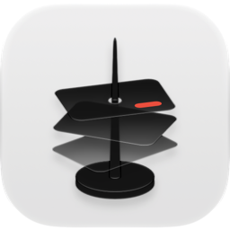

<p align="center">
  
</p>

<h1 align="center">Pendenz</h1>

<p align="center">
  <b>Pen·denz</b>, noun, plural <i>Pendenzen</i>. In Switzerland, the everyday word<br>
  for a matter that is still open and waits to be dealt with.
</p>

<p align="center">
  Fast, native tasks, reminders and notes for iPhone, iPad and Mac,<br>
  kept on a server of your own that AI agents can work from.
</p>

<p align="center">
  <a href="https://github.com/unveroleone/pendenz/actions/workflows/build.yml"></a>
  <a href="LICENSE.md"></a>
  
  
  
</p>

<p align="center">
  <a href="#philosophy">Philosophy</a> ·
  <a href="#what-it-does">What it does</a> ·
  <a href="#status">Status</a> ·
  <a href="#get-started">Get started</a> ·
  <a href="docs/design.md">Design</a> ·
  <a href="docs/self-hosting.md">Self-hosting</a> ·
  <a href="ROADMAP.md">Roadmap</a> ·
  <a href="CONTRIBUTING.md">Contributing</a>
</p>

---

Pendenz is a private app for the things you still have to do. You write an item down on the iPhone or the Mac, and it syncs to a small server you host yourself. An agent with its own token reads and writes the same list through an MCP server or a CLI, so it can add what it finds, report on what it did and take work off the list.

## Philosophy

- **Native and fast.** SwiftUI on iPhone, iPad and a real Mac app, with no web view and no Catalyst. Every list is drawn from a local store, so the app opens on your items before the server has answered, and a change shows the moment you make it. The server is one Rust binary with one SQLite file.
- **One kind of item.** A reminder is an item with a date. It shows in Reminders and in its project at the same time, so nothing has to be moved or converted between lists.
- **Capture first, sort later.** Quick add takes one line and reads the date, the repeat and the project out of it. Whatever has no project waits in the inbox.
- **Items are work, notes are context.** An item is something still to do. A note is something you know. A note can become an item, and an agent searches notes for context but never picks up work from them.
- **Agents work on your list, not on a list of their own.** There is no agent inbox and no hand-over. An agent has its own token, reads what you write, adds what it finds and comments on what it did. The server records who changed a row, so the activity log tells you whether it was you or an agent.
- **Agents never hold the keys.** No agent token can pair a device, see or revoke the paired devices, or remove the lock of a note. The server enforces this, not the instructions an agent reads.
- **You decide what an agent sees.** Hiding an item or a note removes it from everything an agent token can read. A lock is something else: it keeps a note's text off the screen until Face ID, and an agent may still read it under the rule not to keep or copy it.
- **Reminders belong to the device.** Every reminder is a local notification scheduled from the synced data, so it fires offline and while the server is down. The push from the server only says "sync now" and carries no text.
- **Yours to host.** Your items live on your server and on your devices. The only outside piece is the push relay, which knows a device's push token and nothing else.
- **Black and white.** Color only carries state, such as red for overdue.
- **Simple on purpose.** One person uses a server. Protections that only a team would need are left out until they are needed, and [docs/design.md](docs/design.md) says which ones and why.

## What it does

- **Reminders and tasks.** One kind of item. With a date it appears in Reminders and notifies you on the device, with the actions Done, In 1 Hour and Tomorrow. Without a project it sits in the inbox.
- **Quick add.** Type "Call the dentist tomorrow 9:00 #health" and the date and the project are set. Repeats work the same way, in English and German.
- **Notes.** Plain markdown, grouped in the same projects as the items. A note can be turned into an item, and a note can be locked behind Face ID or Touch ID.
- **Projects and images.** A project has a name and an icon, and each list keeps its own order. An item can carry images.
- **Offline.** Every change is written to a local store first and sent when the server is reachable.
- **Sync by push.** After a change the server asks your other devices to sync with a silent push.
- **Widget.** One list widget in three sizes for the home screen and the Mac desktop, set to Reminders, the inbox, a project or all open items. Every row has a tick that completes the item without opening the app.
- **Siri, Shortcuts and Spotlight.** "Add to Pendenz" works without setup, and Shortcuts can add, complete, find and open items and notes. Spotlight finds the open items and the notes on the device, a locked note by its title alone. A New Item control goes into Control Center, on the lock screen or on the Action button.
- **Agents.** The MCP server and the CLI can do what the app can do with items, notes and projects. An item or note you hide does not exist for an agent.
- **Self-hosted.** The server is one Rust binary with one SQLite file. A device pairs with a one-time code.

## Status

Pendenz is in daily use by its author and young as a public project. Expect the API and the app to change between versions.

- [x] **Server, CLI and MCP server.** Items, notes, projects, images, the changes feed, tokens and device pairing.
- [x] **The app for iPhone, iPad and Mac.** Pairing, capture, the lists, reminders, notes, projects, images and sync, built from Xcode.
- [x] **Sync by push**, through a relay that holds the APNs keys.
- [x] **Widget, icon menu, Siri, Shortcuts, Spotlight and the New Item control.**
- [ ] **The App Store.** Until then the app is built from source.

[ROADMAP.md](ROADMAP.md) has the rest.

## Get started

### Host the server

The server runs as two containers, the API and the hosted MCP endpoint, behind HTTPS. [docs/self-hosting.md](docs/self-hosting.md) walks through the setup with a reverse proxy or a Cloudflare Tunnel, pairing the first device, tokens for agents, updates and backups.

### Build the app

Open `apple/Pendenz.xcodeproj` in Xcode 27 and run the `Pendenz` scheme on a simulator or on the Mac. The app runs on iOS 27, iPadOS 27 and macOS 27. It asks for the address of your server and a pairing code from it.

For your own device, build with your team and a bundle ID of your own. The project derives the widget's ID and the app group from `PENDENZ_BUNDLE_ID`:

```sh
xcodebuild -project apple/Pendenz.xcodeproj -scheme Pendenz \
  -destination 'id=<your device>' -allowProvisioningUpdates \
  DEVELOPMENT_TEAM=<your team ID> PENDENZ_BUNDLE_ID=com.example.pendenz build
```

The entitlements for push and the app group need a paid Apple Developer membership. Register the app group `group.<your bundle ID>` in the developer portal and turn it on for the app's ID and the widget's ID (`<your bundle ID>.widgets`); Xcode registers the two IDs by itself. Builds for the Simulator need none of this.

A build under another bundle ID gets no push from the public relay, which only sends to the app it holds keys for. It syncs when it opens, when it comes to the front and on pull to refresh, and reminders work as before because they are local.

### Connect an agent

Add an agent on the server and give it a token:

```sh
docker compose exec api pendenz add-agent --id my-agent --name "My agent"
docker compose exec api pendenz issue-token --actor my-agent --label laptop --scopes read,write
```

Point any MCP client at `https://<your server>/mcp` with the header `Authorization: Bearer <token>`. For an agent on the same machine as a checkout of this repo there is a stdio server and a CLI:

```sh
export PENDENZ_API_URL=https://<your server> PENDENZ_API_TOKEN=pdz_...
pnpm mcp               # stdio MCP server
pnpm pendenz list      # CLI, JSON output
```

The tools carry their own instructions for the agent: how to name items, set dates, append to notes, and what a hidden item or a locked note means.

## Development

Needs Rust 1.100 (rustup picks it up from `rust-toolchain.toml`), Node 24, pnpm 12 and, for the app, Xcode 27.

```sh
pnpm install
pnpm dev:api
```

The API listens on `127.0.0.1:8080` and creates `data/pendenz.db`. In this local mode a request without a token acts as the owner, and the server refuses to start in that mode on any address but loopback.

```sh
curl -X POST http://127.0.0.1:8080/api/items \
  -H 'Content-Type: application/json' -H 'Idempotency-Key: first-item' \
  -d '{"title": "Call the dentist", "due_at": "2026-11-13T09:00"}'
```

Run the app against it with the launch argument `-apiURL http://127.0.0.1:8080`, which skips pairing, or pair with `http://127.0.0.1:8080` and a code from `cargo run --bin pendenz -- pairing-code`.

`pnpm check` runs clippy and the format checks for the server and the agent tools, and `pnpm check:swift` runs SwiftFormat on the app, as CI does. CI also builds the app for the iOS Simulator and the Mac. `apple/uitest.sh` runs the UI tests of the app in the Simulator against two servers it starts itself.

```
server/   Rust API and migrations
agent/    CLI and MCP adapters
apple/    the Xcode project for iPhone, iPad and Mac
relay/    the push relay, a Cloudflare Worker
deploy/   Dockerfiles, compose files, update and backup scripts
docs/     design and self-hosting
```

## Contributing and security

Small, focused pull requests are welcome. Please read [CONTRIBUTING.md](CONTRIBUTING.md) first; larger features start as a discussion. Report security issues privately as described in [SECURITY.md](SECURITY.md).

## License

Pendenz is licensed under the [Functional Source License, Version 1.1, ALv2 Future License](LICENSE.md) (FSL-1.1-ALv2). You may use, self-host, change and share it for any purpose except offering it to others as a competing commercial product or service. Each version becomes available under the Apache License 2.0 two years after its release.
